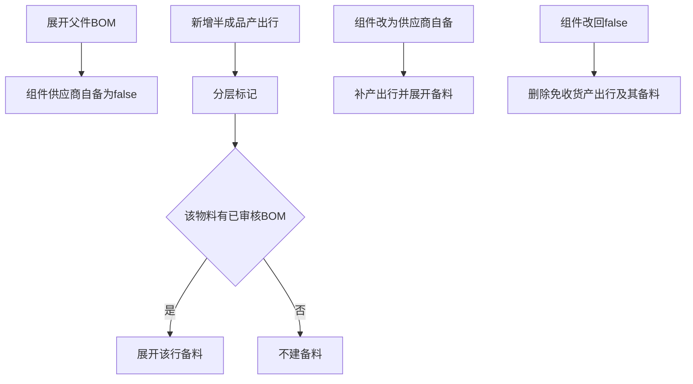

# 委外半成品明细自动补齐

已确认的行为保持不变：[`expandBom`](c:\WorkSpace\WorkSpace\lychee\lychee-backend\lychee-erp-scm\src\main\java\com\lychee\erp\scm\service\impl\OutsourceOrderComponentServiceImpl.java) 仍把每个组件写成 `isSupplierProvided = false`。标记变 true 的现有原因是同一张委外单上已有该物料的产出行，由 [`syncIntermediateLayerMarkers`](c:\WorkSpace\WorkSpace\lychee\lychee-backend\lychee-erp-scm\src\main\java\com\lychee\erp\scm\service\impl\OutsourceOrderLayeringServiceImpl.java) 完成。不新增物料工厂委外属性，不改 MRP，也不减少厂内工单。

## 补齐

在 [`OutsourceOrderItemServiceImpl.createOutsourceOrderItem`](c:\WorkSpace\WorkSpace\lychee\lychee-backend\lychee-erp-scm\src\main\java\com\lychee\erp\scm\service\impl\OutsourceOrderItemServiceImpl.java) 保存并完成现有分层之后：

- 新行物料已经是同单其他产出行的组件，且 [`RemoteBomService.getActiveBom`](c:\WorkSpace\WorkSpace\lychee\lychee-backend\lychee-erp-common\src\main\java\com\lychee\erp\common\service\RemoteBomService.java) 在计划开工日（无则用订单日）能找到已审核 BOM 时，调用 `expandBom`。
- 数量沿用用户在产出行上填写的数量。
- 没有 BOM 的原料不展开、不抛「找不到 BOM」。
- 子件展开出来的组件仍是供应商自备 false，不继续自动建下一层产出行。

在 [`updateOutsourceOrderComponent`](c:\WorkSpace\WorkSpace\lychee\lychee-backend\lychee-erp-scm\src\main\java\com\lychee\erp\scm\service\impl\OutsourceOrderComponentServiceImpl.java)：

- `false` 改为 `true`，物料有已审核 BOM，且同单还没有该物料的产出行：新建一行，数量等于该组件 `requiredQuantity`，然后展开 BOM，再跑分层。分层会把该行 `requiresPhysicalReceipt` 设为 false。
- 同单已有该物料产出行时不另建、不改用户已填数量。
- 原料即使改为供应商自备，也不建产出行。

直接写 repository，避免组件更新和明细创建互相调用。`expandBom` 内部把组件标成自备的路径不走 `updateOutsourceOrderComponent`，避免循环。

## 改回厂内发料

组件从 `true` 改回 `false` 时，删除同单该物料、且 `requiresPhysicalReceipt = false` 的产出行及其备料，再跑分层。`requiresPhysicalReceipt = true` 的产出行保留，避免删掉要从计划订单拉入、需要实物收货的行。

## 前端

[`OutsourceOrderItemList`](c:\WorkSpace\WorkSpace\lychee\lychee-frontend\src\pages\scm\outsource-orders\components\OutsourceOrderItemList.tsx) 在产出行保存后刷新组件表。组件保存后刷新产出行表，使用户勾选供应商自备后能看到新出现的半成品行。

## 测试

在 `lychee-erp-scm` 为上述四条补服务测试：有 BOM 的半成品产出行会带出备料并标成供应商自备；无 BOM 的原料不展开；组件改为自备会补行；改回 false 只删除免收货行。
