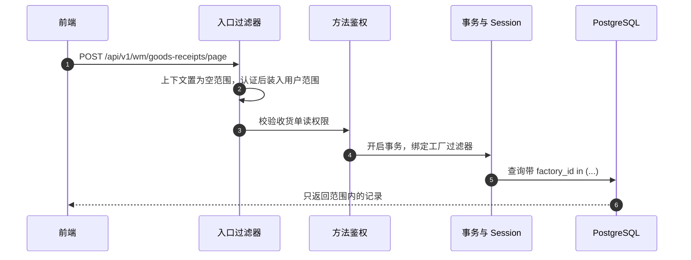

# P1 资料权限设计（收敛稿）

> 本文是 P1 资料权限收敛讨论稿，因功能设计不符合业务实际需求已被放弃，不再作为实现依据。最新落地实现方案请参见 [06-P1资料权限设计-分阶段实施方案.md](./06-P1资料权限设计-分阶段实施方案.md)。
>
> - 前置文档：[01-现状与问题.md](./01-现状与问题.md)、[02-权限现状与交付运维指南.md](./02-权限现状与交付运维指南.md)。功能权限层以 02 和当前代码为准。已落地的业务前置见 [05-P1前置完成项.md](./05-P1前置完成项.md)。
> - 状态：废弃，已被 06 取代。

---

## 目录

- [〇、结论](#〇结论)
- [一、相对 03 的取舍](#一相对-03-的取舍)
- [二、设计前实现](#二设计前实现)
- [三、范围模型](#三范围模型)
- [四、数据模型](#四数据模型)
- [五、求值](#五求值)
- [六、受控资源](#六受控资源)
- [七、运行时](#七运行时)
- [八、参照建单](#八参照建单)
- [九、单据链](#九单据链)
- [十、管理面与前端](#十管理面与前端)
- [十一、异步、导出与导入](#十一异步导出与导入)
- [十二、迁移与上线](#十二迁移与上线)
- [十三、测试与工作量](#十三测试与工作量)

---

## 〇、结论

功能权限继续回答「能不能用这个功能」。资料范围回答「能碰哪些组织」，每个用户只有一份，所有功能共用。

范围只有公司和工厂。仓库不单独配置，库存和过账都落在工厂上。未配置范围时，受控数据为空、受控写入被拒绝。存量用户迁移为「公司 = 全部」，行为和现在一致。

读请求用 Hibernate 过滤器加 `列 in (:ids)`，「全部」不加条件。写请求关闭过滤器，由写守卫检查落库的单据组织；参照建单在已经加载的来源上再做一次同样的判断。单据链的递归查询不改，展示时按用户范围打码。

---

## 一、相对 03 的取舍

| 03 的能力 | 本文 |
|---|---|
| 范围挂在角色指派上，按权限串分别求并集 | 范围挂在用户上，所有权限串共用 |
| 公司、工厂、仓库三维，未设定则向下推导 | 只有公司、工厂。工厂未设定时，才从公司展开到其下全部工厂 |
| `ALL` / `HOME` / `LIST` / 含下级 | 只有「全部」和「指定」。所属、含下级只作为界面上的一次性填入 |
| 行规则：全部 / 本部门 / 本部门及下级 / 本人，查看和操作分开 | 不做。能看到某组织，就能在该组织上做已授权的动作 |
| 读模式过滤全部共享资源，写模式只过滤主资源 | 读请求过滤受控资源。写请求不过滤，写守卫检查主资源 |
| 下拉带 `X-Lychee-Scope-For`，按当前页面收窄 | 下拉使用该用户的范围 |
| 导出快照，他人下载时比较范围是否覆盖 | 执行时按创建者重新装入范围。下载沿用现有的创建者限制 |
| 参照配置「仅本页」隔离 | 参照配置与主数据一样，租户内共享 |
| 约 60 个实体上的行规则 SQL | 每个受控资源一条 `列 in (:ids)`，由登记表生成 |

因此不再提供：同一人按功能使用不同组织；把同工厂的人限制在某个仓库；只看本部门或只看本人；查看宽于操作；下拉按页面收窄；他人凭范围覆盖关系下载导出文件。

用户调公司、公司新增下级时，范围不自动变化。「全部」覆盖以后新建的组织。指定 ID 只有重新保存才变。

工作代理、字段权限、PostgreSQL RLS 不在本文。过滤器条件里不预留行规则参数。

---

## 二、设计前实现

下面两件事缺了事实，本文不把它们设计成另一套机制。讨论并改完代码后，把结论补进标注的小节。

### 1. Hibernate 过滤器的绑定与覆盖面

`lychee-erp` 的 `spring.jpa.open-in-view` 为 `true`。Session 在权限上下文确定之前就打开，不能在打开 Session 时绑定过滤器。仓库里还没有 `@Filter`。

本文只确定：读请求用过滤器，条件由登记表生成，空集合用哨兵 `-1`。事务开始时如何绑定、`findById` 是否过滤、分页 count、join 的条件加在哪里，验证后写入第七节，不在验证前选定 `JpaDialect` 或 `autoEnabled` 解析器。

同时核对：用户直接触发的 `@Modifying` 和原生 SQL 是否会改受控表。已知的原生 SQL 里，`PurchaseOrderRepository`、`OutsourceOrderRepository` 的 `existsOpenByCompanyId` 是停用公司时的全量检查，保持不受控；`OrderPeggingRepository` 的追溯按第九节处理。若还有别的用户入口绕过过滤器，补进第七节的例外，不另做拦截框架。

### 2. 参照建单的来源对象缺少组织字段

断言是 `requireCompany` / `requireFactory`，做在参照建单已经加载到的来源对象上。共享的 remote 查询同时给定时任务、打印和数量回写使用，不在那些方法里加过滤，也不按权限串再查一遍。

下列路径手里的对象没有组织字段，实体上是有的。先把字段从已加载的单据头抄到这个对象上，再把调用点补进第八节。

| 路径 | 当前对象 | 组织所在 | 对象上缺少 |
|---|---|---|---|
| 工厂订单 ← 销售订单 `addItemsFromSalesOrders` | `RemoteSalesOrderDTO`、`RemoteSalesOrderItemDTO` | `SalesOrder.companyId`。`getSalesOrders` / `getSalesOrderItems` 已经加载订单头，映射时丢掉了 | `companyId` |
| 出货单 ← 销售订单 `DeliveryItemServiceImpl` | 只加载了 `SalesOrderItem` | `SalesOrder.companyId` | 该路径没有订单头 |
| 收货 ← 采购订单行 `processPoConversion` | `RemotePurchaseOrderItemLineForGoodsReceiptDTO` | `PurchaseOrder.factoryId` | `factoryId` |
| 收货 ← 委外订单行 `processOutsourceConversion` | `RemoteOutsourceOrderItemDTO` | `OutsourceOrder.factoryId` | `factoryId` |
| 领料 ← 生产订单组件 `batchCreateItemsFromProduction` | `RemoteProductionOrderComponentDTO` | `ProductionOrder.factoryId` | `factoryId` |
| 调拨 ← 委外组件 `batchCreateItemsFromOutsource` | `RemoteOutsourceOrderComponentDTO`。请求体另带 `outsourceOrderId` | `OutsourceOrder.factoryId` | `factoryId` |

出货单这条是加载路径没有把头取出来，不是 DTO 少一个字段。补法是在现有校验里使用已经存在的销售订单头，不新增通用的按 ID 反查层。

---

## 三、范围模型

每个用户一份范围，与 `user_roles` 无关。角色仍然只授予功能权限。

公司、工厂各自三种状态：

| 状态 | 存储 | 含义 |
|---|---|---|
| 未设定 | 该维度没有行 | 见下方展开规则 |
| 全部 | `scope_type = ALL`，一行 | 该维度不加条件，包含以后新建的组织 |
| 指定 | `scope_type = LIST`，每个 ID 一行 | 只含这些 ID |

展开规则：

| 用户范围 | 公司级单据 | 工厂级单据和库存 |
|---|---|---|
| 公司 = 全部 | 全部 | 全部。若另外指定了工厂，工厂级以指定为准 |
| 公司 = 指定，工厂未设定 | 这些公司 | 这些公司下的全部工厂，包含以后新建的工厂 |
| 公司 = 指定，工厂 = 指定 | 这些公司 | 指定的工厂 |
| 公司未设定，工厂 = 指定 | 无 | 指定的工厂 |
| 两个维度都未设定 | 无 | 无 |

公司未设定时，不从工厂向上推出公司。工厂级岗位要引用销售订单、财务单据时，必须同时指定公司。

保存时校验：

- 同一维度不能既有「全部」又有「指定」。
- 指定的组织必须存在。
- 公司已指定或为「全部」以外的情况：指定工厂的 `company_id` 必须落在公司集合内。公司未设定时，不套这条。
- 授出的公司集合、工厂集合都必须落在管理员自己的有效范围里。授出「全部」时，管理员该维度也必须是「全部」。

界面可以用「所属公司」「包含下级公司」预填 ID。保存的是这些 ID 或「全部」，不保存 `HOME`、`include_children`。新指派范围的默认预填是用户所属公司，以及该公司下当前的工厂，保存前必须确认。所属公司为空时不预填，由管理员指定。

---

## 四、数据模型

### 1. `user_data_scopes`

```sql
CREATE TABLE lychee_erp.user_data_scopes
(
    id bigserial NOT NULL,
    tenant_id bigint NOT NULL,
    user_id bigint NOT NULL,
    dimension varchar(20) NOT NULL,
    scope_type varchar(10) NOT NULL,
    value_id bigint NULL,
    created_at timestamp without time zone NULL DEFAULT CURRENT_TIMESTAMP,
    updated_at timestamp without time zone NULL DEFAULT CURRENT_TIMESTAMP,
    created_by bigint NULL,
    updated_by bigint NULL,
    CONSTRAINT user_data_scopes_pkey PRIMARY KEY (id),
    CONSTRAINT fk_user_data_scopes_user FOREIGN KEY (user_id)
        REFERENCES lychee_erp.users (id) ON DELETE CASCADE,
    CONSTRAINT ck_user_data_scopes_dimension CHECK (dimension IN ('COMPANY', 'FACTORY')),
    CONSTRAINT ck_user_data_scopes_type CHECK (scope_type IN ('ALL', 'LIST')),
    CONSTRAINT ck_user_data_scopes_value CHECK ((scope_type = 'LIST') = (value_id IS NOT NULL))
);

CREATE UNIQUE INDEX uk_user_data_scopes
    ON lychee_erp.user_data_scopes (user_id, dimension, scope_type, COALESCE(value_id, 0));
```

没有行表示该用户没有资料范围。删除用户时由数据库外键 `ON DELETE CASCADE` 删除范围行。JPQL 批量删除不会走实体级联，但会走这条外键。

不建 `role_row_rules`，不给 `export_jobs` 加 `scope_snapshot`。

### 2. 组织列索引

受控表补 `(tenant_id, company_id)` 或 `(tenant_id, factory_id)`。清单在实现时用 `pg_indexes` 对照第六节的资源表生成，使用 `CREATE INDEX IF NOT EXISTS`。明细经单据头子查询，确认明细表上已有单据头外键索引。

### 3. 迁移

1. 建 `user_data_scopes` 和索引。
2. 每个已有用户插入一行 `COMPANY / ALL`：

```sql
INSERT INTO lychee_erp.user_data_scopes (tenant_id, user_id, dimension, scope_type)
SELECT u.tenant_id, u.id, 'COMPANY', 'ALL'
FROM lychee_erp.users u
WHERE NOT EXISTS (
    SELECT 1 FROM lychee_erp.user_data_scopes s WHERE s.user_id = u.id
);
```

03 第五节里预置 `SYS_IT_ADMIN`、`SYS_HR_ADMIN`、删除草稿表、`putIfAbsent` 改为 `put`、测试 CI，与范围模型无关，仍按 03 的 P1-0 做。`SYS_HR_ADMIN` 指派给 HR 时，范围用上面的「公司 = 全部」。IT 若只做配置，不插入范围行。

### 4. 接口

- `POST /adm/users`、`PUT /adm/users/{id}` 增加 `scopes`。元素为 `dimension`、`scopeType`、`valueId`。新建时必填，空列表表示无资料范围。修改时 `null` 表示不变，非 `null` 表示整体替换。
- `UserResponse` 增加 `scopes` 和 `scopeSummary`，例如「公司：C1；工厂：其下全部」。
- `UserAuthorities` 增加范围行和所属公司、所属工厂。组织展开不放进缓存，求值时用组织目录现算。改范围、改用户所属组织时驱逐该用户的权限缓存。改公司、工厂主数据时只驱逐组织目录缓存。

---

## 五、求值

```java
EffectiveScope resolve(UserAuthorities user) {
    // 公司：未设定为空集；ALL 保留标记；LIST 为 ID 集
    // 工厂：未设定时，公司 ALL → 工厂 ALL；公司为指定 → 这些公司下的工厂；公司未设定 → 空
    //       已指定时用指定 ID，不再展开
}
```

同一请求只求值一次。仓库不产生独立集合。库存表有 `factory_id`，直接用工厂集合。

`EffectiveScope` 只有两个维度，每个维度是「全部」或一个 ID 集。写守卫、参照建单、下拉、单据链打码都用它，不按权限串再算。

---

## 六、受控资源

登记在实体上，启动时 `DataScopeRegistry` 扫描。字段不存在、维度和字段对不上、明细的父实体未登记，启动失败。

```java
@DataScopeResource(dimension = Dimension.FACTORY, field = "factoryId")
public class PurchaseOrder extends AuditableEntity { }

@DataScopeResource(dimension = Dimension.FACTORY, parent = PurchaseOrder.class,
        parentField = "purchaseOrderId")
public class PurchaseOrderItem extends AuditableEntity { }
```

过滤器条件由登记表生成，不在实体上手写 SQL。单据头和台账是 `factory_id in (:dsFactoryIds)` 或 `company_id in (:dsCompanyIds)`。明细是单据头 ID 落在父表的子查询里。该维度为「全部」时不启用对应过滤器。

资源划分沿用 03 第七节的单据清单，只改这三处：

- 维度只有公司或工厂。`stock_on_hand`、`stock_transactions`、`inventory_balances` 使用已有的 `factory_id`，不按仓库过滤。
- 03 中「仅本页」的参照配置不登记：会计期间、成本政策、科目确定、税务确定、物料工厂设置、货源清单、MRP 参数、库存期间。
- 不登记部门字段、负责人字段、共享方式、过账校验仓库。

公司级：日记账、应付/应收发票及贷项、付款、固定资产与折旧、成本计算/分摊/材料成本、公司银行账户、销售订单、销售预测。

工厂级：出货、请购、采购订单、委外订单、收货、采购退货、客户退货、领料、领料退回、调拨、盘点、生产订单、生产报工、倒冲异常、计划订单、MRP 运行与结果、工厂订单，以及上述三张库存表。

明细跟随单据头。物料、BOM、工艺、供应商、客户、业务伙伴、科目、税码、付款条件、币别、汇率、单位、单据编号、选项、菜单、角色、权限不受控。汇率带 `company_id`，仍做参照，不登记。

用户实体不登记。用户管理的过滤写在用户查询上：`users.company_id` 落在管理员的公司集合内。公司未设定的管理员看不到用户。这样人名显示不会被过滤器截断。

---

## 七、运行时

绑定方式待第二节第 1 项验证后补充。本节其余部分不依赖该结论。

### 1. 上下文

Web 请求进入时，上下文是空范围。认证通过后装入该用户的有效范围，请求结束时清除。装入与当前权限串无关。

没有上下文的线程也是空范围。系统作业必须显式调用 `DataScope.unrestricted()`，调用结束恢复原上下文。

| 入口 | 处理 |
|---|---|
| `ExportJobEventListener` | 事件里已有创建者的 `Authentication`。装入该用户的范围 |
| `ImportJobEventListener` | 同上，写守卫仍生效 |
| `MrpRunEventListener` | `unrestricted()`。运行上的工厂在发起时已由写守卫检查；计算要读公司级需求 |
| `MrpScheduleJob` | `unrestricted()` |
| `ExchangeRateSyncJob` | `unrestricted()` |

以后新增的异步或定时入口，在代码评审里显式选一种。漏了就是空范围，查不到受控数据，写不进受控单据。

### 2. 读

读动作是 `read`、`export`。有效范围里非「全部」的维度启用对应过滤器。列表、详情、分页 count、导出查询走同一套条件。

`isAuthenticated()` 且会读出受控资料的接口，也按该用户的范围过滤，不增加请求头。03 附录 C 里读组织、库存台账、公司银行账户的接口属于这类。读主数据或参照配置的，声明 `@DataScope(exempt = "理由")`。

组织下拉继续按租户缓存全集，返回前过滤：公司下拉是公司集合，工厂下拉是工厂集合，仓库下拉是这些工厂下的仓库。工厂岗位的公司集合为空时，公司下拉为空；工厂名称上的公司名来自工厂主数据，不表示可以打开公司级单据。

单条读不到时返回 404，与不存在相同。

### 3. 写

写请求不启用过滤器。过账、回写、倒冲在同一请求里读取范围外单据时不受影响。

写守卫在 Hibernate 插入和更新前执行，检查受控单据头的新值：

- 公司级资源的 `companyId` 落在公司集合内。
- 工厂级资源的 `factoryId` 落在工厂集合内。
- 不能把单据改到范围外。

越界抛 `DataScopeDeniedException`（403，`error.data.scope.denied`）。flush 时的异常包装在第二节验证里确认，全局异常处理沿 cause 链识别。

写模式下按 ID 能加载到范围外的单据。守卫在提交前拒绝，事务回滚，响应里不会带出该单据。批量接口因此也不会把范围外 ID 当成不存在而静默跳过。

`@DataScope(mode = READ)` 用于权限动作不是 read/export、但实际只查询的接口，例如 `POST /scm/purchase-orders/pending-mrp-items/page`。覆盖测试要求：路径以 `/page`、`/list` 结尾或使用 GET、但动作不是 read/export 的处理器，必须显式声明模式。

### 4. 开关

```yaml
lychee:
  security:
    data-scope:
      enabled: true          # false：不启用过滤器，不做写守卫和来源断言
      write-guard: ENFORCE   # ENFORCE 拒绝；LOG 只记日志
```

### 5. 一次读请求



---

## 八、参照建单

写请求不过滤，来源单能被加载。新单据的组织若抄自来源，写守卫能挡住「在范围外建单」；挡不住「在范围内的单据上抄写范围外来源的数量和价格」。来源断言补的是后一种。

```java
void requireCompany(Long companyId); // 公司级来源
void requireFactory(Long factoryId); // 工厂级来源
```

「全部」直接通过。ID 不在集合内，或控制字段为 null，返回 403。断言放在参照建单方法里，放在来源对象已经加载之后。不放进共享 remote 方法。

选择器列表走第七节的读过滤，不能代替断言。请求体里的 ID 可以不来自选择器。

### 1. 已经可以写上的调用点

| 路径 | 来源对象上的组织 | 断言 |
|---|---|---|
| 采购订单 ← MRP 结果 | `RemotePendingMrpPurchaseItemDTO.factoryId` | `requireFactory` |
| 采购订单 ← 请购 | `PurchaseRequisition.factoryId` | `requireFactory` |
| 采购订单行 ← 请购 | 同上 | `requireFactory` |
| 领料 ← 出货单 | `RemoteDeliveryItemDTO.factoryId` | `requireFactory` |
| 工厂订单 ← 销售预测 | `RemoteSalesForecastItemDTO.companyId` | `requireCompany` |
| 计划订单 ← MRP 结果 | `MrpResult.factoryId` | `requireFactory` |
| 应付发票 ← 收货单 | `RemoteGoodsReceiptForApInvoiceDTO.factoryId` | `requireFactory` |
| 应收发票 ← 出货单 | `RemoteDeliveryForBillingDTO.factoryId` | `requireFactory` |
| 应付贷项 ← 应付发票 | `ApInvoice.companyId` | `requireCompany` |
| 应收贷项 ← 应收发票 | `ArInvoice.companyId` | `requireCompany` |
| 固定资产 ← 应付发票行 | `ApInvoice.companyId` | `requireCompany` |
| 采购退货保存时引用的收货单 | `GoodsReceipt.factoryId`（`requirePostedPurchaseReceipt`） | `requireFactory`。之后的 `batch-from-receipt` 只允许该收货单的行 |
| 客户退货、领料退回保存时引用的领料单 | `StockIssue.factoryId` | `requireFactory`。之后的 `batch-from-issue` 只允许该领料单的行 |

### 2. 待第二节第 2 项补完后写入

工厂订单 ← 销售订单、出货单 ← 销售订单、收货 ← 采购订单、收货 ← 委外订单、领料 ← 生产订单、调拨 ← 委外订单。调用点不在本文先写一版绕行查询。

### 3. 不再单独断言

| 路径 | 原因 |
|---|---|
| 计划订单批量转生产订单 | 来源就是主资源，写守卫覆盖 |
| 盘点按本单生成账面 | 查询条件是盘点单上的 `factoryId`、`warehouseId`，主资源由写守卫覆盖 |
| 委外订单拉计划订单 | `getPendingOutsourceOrders(order.getFactoryId(), ids)` 已用目标单工厂限制来源，主资源由写守卫覆盖 |
| 库存期间同步会计期间、BOM 生成 | 来源不受控 |

---

## 九、单据链

`order_peggings` 没有公司、工厂列。追溯 ID 多数是行 ID。`findUpstreamTrace`、`findDownstreamTrace` 保持现在的递归 CTE，不把范围写进 SQL，也不给这张表加过滤器。MRP、工厂订单分配、预测消耗、打印对这张表的读写保持全量。

控制只加在 `OrderPeggingServiceImpl` 的三棵树接口上，在现有 enricher 填完节点之后：

1. enricher 把已经加载到的单据头组织写到节点上。销售订单、销售预测写 `companyId`，其余写 `factoryId`。单据头没加载到时，组织留空。
2. 起点的组织不在用户范围内，或组织为空：整棵树 404。功能权限仍是起点类型的 `readAuthority`。
3. 其他节点组织不在范围内或为空：保留类型和 ID，清掉单号、状态、单据数量、挂钩数量。物料编码和名称可以保留。前端把这种节点显示为无权查看。

不按节点再查每种单据的读权限。不把范围外节点从树上剪掉，这样工厂岗位仍能看到「上面还有一张销售订单，但无权查看」。

现有 enricher 在单据头缺失时仍可能从明细行写入数量。第 3 步以组织是否在范围内为准清掉这些字段，不依赖 `findAllById` 被过滤器拦住。

---

## 十、管理面与前端

范围编辑器放在 `src/pages/adm/users/components/UserForm.tsx`，不放在每条角色指派上。公司、工厂各一行，选项为「未设定 / 全部 / 指定」。指定时多选。底部按第三节的表显示生效摘要。

`userColumns.tsx` 增加范围摘要列。`src/requestConfig.tsx` 不增加范围请求头。业务页面不改；保存被拒时显示后端消息。

用户列表和用户详情按第六节过滤。管理员保存的范围必须落在自己的有效范围里，否则 `validation.user.data.scope.not.covered`。不能通过改自己的用户来放宽自己的范围（沿用不能改自己授权的约束；若当前用户更新接口允许改自己的档案，范围字段在改自己时忽略）。

交付时 HR 的范围是「公司 = 全部」。IT 可以不配范围：功能权限还在，受控单据看不到，也不能管理用户。需要 IT 处理业务数据时，再配「公司 = 全部」。

文案补 zh-CN、en-US、vi-VN：

- `error.data.scope.denied`
- `validation.user.data.scope.invalid`
- `validation.user.data.scope.not.covered`

---

## 十一、异步、导出与导入

导出、导入的监听器已经把发起人的 `Authentication` 放进工作线程。本文在此之后装入该用户的范围。导出查询因此和同步列表使用同一份范围。不保存范围快照；排队期间范围变了，文件按执行时的范围生成。

作业列表保持现状：没有 `/report/export-jobs:read` 的人只看到自己创建的作业，有该权限的人看到全部。下载收紧为只有创建者能下，并继续重验 handler 权限。当前 `requireOwnedByCurrentUser` 在 `canReadAllJobs()` 时放行他人下载，这一支去掉，避免再做「范围是否覆盖文件」的比较。

导入逐行落库，写守卫拒绝的行按现有导入框架记失败，错误码 `error.data.scope.denied`。

---

## 十二、迁移与上线

1. P1-0：第二节的过滤器验证；03 中的系统角色、草稿表、`putIfAbsent`、测试 CI。
2. 发布范围功能时 `data-scope.enabled = true`、`write-guard = LOG`。存量用户都是「公司 = 全部」，行为不变。观察写守卫有没有误报。
3. 实施人员从工厂、仓库岗位开始把范围改成指定公司或指定工厂。
4. 一到两周没有误报后，`write-guard = ENFORCE`。

回退：`data-scope.enabled = false` 并重启。表保留，不回滚迁移。

发版给 `SYS_IT_ADMIN` 补权限的 SQL 片段仍按 03 第十一节，写入后端开发约定。

---

## 十三、测试与工作量

单元测试覆盖第三节的五行之表、管理范围子集、写守卫、来源断言、单据链打码和起点 404。

集成测试用两个公司、各一个工厂。用户四种：全部、只 C1、只 F1、无范围。每类单据验证列表、详情、修改、过账、批量。参照建单验证第八节两类调用点。单据链验证跨公司节点被打码，且 MRP 计算不受影响。

工作量按一名熟悉代码的后端和一名前端粗估。第二节的验证算在 P1-0 里；第二节第 2 项的字段补齐约 1 人日，不包含进下面的功能开发，补完才写第八节余下的调用点。

| 块 | 人日 |
|---|---|
| P1-0：过滤器验证、03 的准备项 | 4–5 |
| 表、缓存、求值、上下文、登记与生成条件 | 4 |
| 写守卫、异常映射 | 1.5 |
| 第八节已列调用点；第九节打码 | 2 |
| 下拉过滤、导出导入装入范围、五个异步入口 | 1.5 |
| 用户范围 API 与上限 | 1.5 |
| 前端范围编辑器、摘要列、i18n | 1.5 |
| 集成测试 | 2 |
| 合计 | 约 18–20 |

第八节待补的六条路径，字段补齐后各加一行断言，不另估一轮设计。
