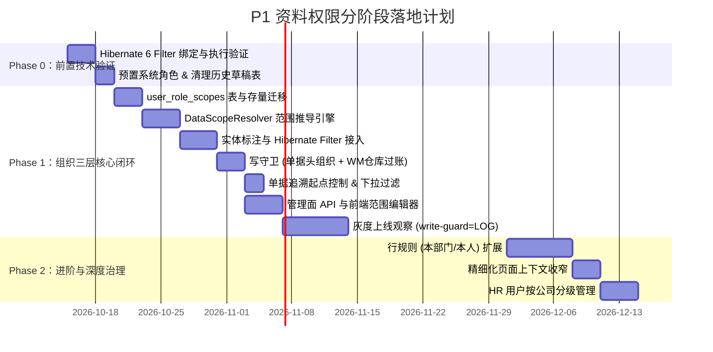

# P1 资料权限设计（分阶段实施方案）

> 本文是 P1 资料权限的最终落地实现依据，基于 [03-P1资料权限设计.md](./03-P1资料权限设计.md) 为基準進行評估與收斂，取代 [04-P1资料权限设计-收敛稿.md](./04-P1资料权限设计-收敛稿.md)。
>
> - **前置文档**：[01-现状与问题.md](./01-现状与问题.md)（漏洞评估与路线）、[02-权限现状与交付运维指南.md](./02-权限现状与交付运维指南.md)（P0 运行模型）、[05-P1前置完成项.md](./05-P1前置完成项.md)（已完成的业务前置）。
> - **核心决策**：
>   1. **保留 03 设计的三层组织模型**：坚持资料范围挂载在角色指派（`user_roles`）上，支持公司（Company）、工厂（Factory）、仓库（Warehouse）三级，支持多身份灵活授权与仓库级精准管控。
>   2. **异步部分全面解耦**：暂不引入异步线程范围快照（JSONB）与跨用户下载范围包含判定，异步与定时任务维持系统特权，导出下载沿用现有创建者防护机制。
>   3. **单据追溯（`order_peggings`）仅在起点控制**：在追溯树入口校验起点单据的组织归属，合法则整树放行，不进行关联链逐节点跨模块鉴权或打码。
>   4. **依托已落地的业务前置大幅降低写守卫复杂度**：依托 2026-10-06 已上线的「来源组织一致性」业务校验，写守卫只需守住目标单据头，免去 25 个参照建单接口的大规模代码侵入。
>   5. **分阶段实施控制系统复杂度**：行规则（本部门/本人）与页面上下文收窄后移至 Phase 2，Phase 1 聚焦组织三层核心闭环。

---

## 目录

- [〇、结论与核心决议](#〇结论与核心决议)
- [一、03/04 方案对比与收敛决策](#一0304-方案对比与收敛决策)
- [二、概念模型与范围求值规则](#二概念模型与范围求值规则)
- [三、数据模型与迁移](#三数据模型与迁移)
- [四、受控资源与 ORM 过滤机制（读模式）](#四受控资源与-orm-过滤机制读模式)
- [五、写守卫与一致性保障（写模式）](#五写守卫与一致性保障写模式)
- [六、单据追溯控制（`order_peggings`）](#六单据追溯控制order_peggings)
- [七、异步与后台作业策略](#七异步与后台作业策略)
- [八、管理面与前端改造](#八管理面与前端改造)
- [九、分阶段实施路线图（Phase 0 ~ Phase 2）](#九分阶段实施路线图phase-0--phase-2)
- [十、迁移、上线与回退策略](#十迁移上线与回退策略)
- [十一、测试策略与质量保障](#十一测试策略与质量保障)

---

## 〇、结论与核心决议

**业务核心痛点**：当前系统的功能权限（如 `/scm/purchase-orders:read`）只回答「能不能用这个功能」，没有任何记录级限制。持有权限的用户可查阅和操作全租户所有公司、所有工厂、所有仓库的数据，多公司/多工厂上线即面临直接越权风险。

**方案一句话**：范围依附在角色指派（`user_roles`）上，分为公司、工厂、仓库三层；读取时由 Hibernate 过滤器在 ORM 层透明追加组织条件；写入时由「目标单据头写守卫 + WM 仓库过账校验」守住边界；单据追溯只在起点把关；异步与行规则解耦后移，实现系统复杂度可控的分阶段逐步上线。

```
                    【HTTP / Web API 请求入口】
                              │
               ┌──────────────┴──────────────┐
               ▼                             ▼
       ┌───────────────┐             ┌───────────────┐
       │   同步 Web 請求 │             │  異步/定時任務   │
       └───────┬───────┘             └───────┬───────┘
               │                             │
    [DataScopeAdvice 解析權限串]                │
    [按指派計算 公司/工廠/倉庫 有效範圍]           ▼
               │                     ┌───────────────┐
       ┌───────┴───────┐             │ 系統級特權執行  │
       ▼               ▼             │  (無動態過濾)  │
  【讀模式】       【寫模式】          └───────────────┘
  Hibernate       寫守衛檢查
   Filter        (目標單頭組織
 (三維 IN 條件)   + WM 倉庫過賬)
```

### 关键架构决议：

1. **三维组织，向下继承，不向上推导**：
   - 支持公司（`COMPANY`）、工厂（`FACTORY`）、仓库（`WAREHOUSE`）三维。
   - 设定公司自动向下覆盖其全部工厂及工厂下全部仓库；设定工厂自动向下覆盖其全部仓库；单独设定仓库时以指定仓库为准。
   - 不向上推导：仅有工厂权限的人无法查阅公司级单据（销售订单、财务单据）。若工厂岗位需引用销售订单，指派时须显式配置公司。
2. **范围跟随角色指派，按权限串求并集**：
   - 范围挂载在 `user_roles`（指派）而非 `users`（用户）上。同一个人可以在 A 工厂持有「仓管」角色（限定 A 厂 W1 仓），同时持有全集团的「采购查询」角色。
   - 判定某个权限串时，只聚合持有该权限串的有效指派的范围并集。
3. **读宽写窄，透明过滤**：
   - **读请求**：ORM 层 Hibernate Filter 统一追加 `company_id in (:ids)`、`factory_id in (:ids)` 或 `warehouse_id in (:ids)`。「全部」时跳过过滤。服务层 500+ 处 `findById` 与 130+ 处 Specifications 零侵入。
   - **写请求**：关闭读过滤器，避免连带处理（扣减库存、回写在途量等）被误伤；通过写守卫检查落库单据头组织，WM 模块过账时额外校验出入库仓库。
4. **单据追溯仅控起点**：
   - `OrderPeggingServiceImpl` 入口校验起点单据是否在用户范围内；合法则全链递归放行，不再逐节点跨服务打码。
5. **异步任务解耦**：
   - 暂不实施跨线程 JSON 范围快照与包含度算法；导出下载严格沿用创建者防越权机制；定时与批处理任务维持系统特权。
6. **分阶段可控演进**：
   - 复杂行规则（本部门/本人）及精细页面上下文收窄独立为 Phase 2，确保 Phase 1 核心三层架构迅速稳定上线。

---

## 一、03/04 方案对比与收敛决策

04 收敛稿为了降低实现难度，将资料范围改为用户全局单一配置，并裁剪了仓库维度的配置。但这与制造与供应链 ERP 的物理现实严重脱节：

| 关注维度 | 03 原案 | 04 收敛稿 | 本分阶段实施方案（06） | 决策理由 |
|---|---|---|---|---|
| **范围挂载点** | 角色指派 `user_roles` | 用户全局 `users` | **角色指派 `user_roles`** | ERP 必然存在一人身兼多职（如 A 厂仓管 + 集团只读），全局绑定会导致权限互斥或过度放大。 |
| **组织层级** | 公司、工厂、仓库三级 | 仅公司、工厂两级 | **公司、工厂、仓库三级** | 仓库是库存台账与出入库实物的法定边界，保税仓/危化品仓等必须精细隔离。 |
| **异步处理** | `export_jobs.scope_snapshot` + 范围覆盖比对 | 无快照，重新取用户范围 | **解耦，暂不处理** | 跨线程范围快照反序列化与多维范围覆盖判定算法复杂度极高，先采用创建者隔离闭环。 |
| **单据追溯** | 遍历节点并跨模块查详情打码 | 富化后逐节点打码 | **仅在起点控制** | 起点合法即代表用户有权探查该业务链条，全链递归放行性能最佳且逻辑纯粹。 |
| **参照建单** | 25 个接口手写来源校验 | DTO 补字段后断言 | **写守卫防守单据头即可** | [05-P1前置完成项.md](./05-P1前置完成项.md) 已完成「来源组织一致性」业务校验，目标单头合规即不可能混入外厂来源。 |
| **行规则** | P1 包含本部门/本人 | 完全删除 | **后移至 Phase 2** | 95% 的核心痛点是跨公司、跨厂、跨仓越权；行规则的 SQL 模板极其复杂，后移可显著降低首期风险。 |

---

## 二、概念模型与范围求值规则

### 1. 核心概念

- **功能权限（Authority）**：格式为 `菜单路径:动作`，例如 `/wm/goods-receipts:post`。
- **指派（Grant）**：`user_roles` 记录，代表某用户在特定租户下持有一个角色，具备有效期与启用状态。
- **指派范围（Scope）**：挂载在 `user_roles` 上的三维范围记录（`user_role_scopes`）。
- **有效范围（EffectiveScope）**：针对某个具体权限串，聚合所有持有该权限串的有效指派，展开并计算并集后的最终三维集合（`companyIds`, `factoryIds`, `warehouseIds`），以及各维度的 `isAll` 标记。

### 2. 单条指派的三级展开推导规则

对于单条角色指派 $g$：
1. **公司集合 $C(g)$**：
   - `ALL`：标记为全部公司；
   - `HOME`：动态取被授权用户的所属公司 `users.company_id`；
   - `LIST`：取指定的公司 ID 列表。若勾选 `include_children = true`，则递归展开包含该公司的全部下级子公司。
2. **工厂集合 $F(g)$**：
   - 显式配置工厂行：取工厂行的并集（`HOME` 取用户 `users.factory_id`）；
   - **未配置工厂行**：自动向下继承，展开为 $C(g)$ 下的全部工厂（若 $C(g)$ 为全部，则工厂亦为全部）。
3. **仓库集合 $W(g)$**：
   - 显式配置仓库行：取仓库行的并集；
   - **未配置仓库行**：自动向下继承，展开为 $F(g)$ 下的全部仓库（若 $F(g)$ 为全部，则仓库亦为全部）。

#### 典型配置展开示例矩阵：

| 指派范围配置 | 公司级单据可见范围 | 工厂级单据可见范围 | 仓库台账与过账范围 | 业务场景说明 |
|---|---|---|---|---|
| `公司 = 全部` | 全部公司 | 全部工厂 | 全部仓库 | 集团财务主管、集团审计 |
| `公司 = C1` | C1 | C1 下全部工厂 | C1 下全部仓库 | 子公司全盘业务人员 |
| `公司 = C1 (含下级)` | C1 及其子公司 | 对应所有工厂 | 对应所有仓库 | 区域/事业部管理人员 |
| `公司 = 所属` | 用户所属公司 | 其下全部工厂 | 其下全部仓库 | 本部通用业务角色 |
| `工厂 = F1` | **无**（不可见） | F1 | F1 下全部仓库 | 纯工厂生产、出入库人员 |
| `工厂 = F1，仓库 = W1` | **无**（不可见） | F1 | **仅 W1 仓库** | 车间产线仓管、原料专管员 |
| `公司 = C1，工厂 = F1` | C1 | F1 | F1 下全部仓库 | 兼顾销售订单查看的工厂厂长 |
| `未配置任何范围行` | 无 | 无 | 无 | 无资料权限（功能可用，数据全空） |

> **配置建议规则**：组织**不向上推导**。工厂岗位如果需要在业务中参照或查看公司级单据（如出货引用销售订单、工厂订单引用销售订单），在指派该角色时必须同时指定公司范围。

### 3. 多指派按权限串合并计算

用户在系统内执行操作或发起查询时，必须持有对应的功能权限串 $A$。

1. **筛选有效指派**：找出用户名下所有处于启用状态、未过期且其角色包含权限串 $A$ 的指派列表 $\text{Grants}(A)$。
2. **逐维度求并集**：
   - 公司维度：$C_{\text{eff}} = \bigcup_{g \in \text{Grants}(A)} C(g)$。若任一 $C(g)$ 为全部，则 $C_{\text{eff}}$ 标记为 `isAll = true`。
   - 工厂维度：$F_{\text{eff}} = \bigcup_{g \in \text{Grants}(A)} F(g)$。若任一 $F(g)$ 为全部，则 $F_{\text{eff}}$ 标记为 `isAll = true`。
   - 仓库维度：$W_{\text{eff}} = \bigcup_{g \in \text{Grants}(A)} W(g)$。若任一 $W(g)$ 为全部，则 $W_{\text{eff}}$ 标记为 `isAll = true`。
3. **请求级缓存**：计算结果保存在线程上下文 `DataScopeContext` 中，同一次 HTTP 请求内同一权限串仅计算一次。

---

## 三、数据模型与迁移

### 1. 表结构设计：`user_role_scopes`

在 `lychee-erp` 库中新建 `user_role_scopes` 表，通过外键严格绑定到 `user_roles`：

```sql
CREATE TABLE lychee_erp.user_role_scopes
(
    id bigserial NOT NULL,
    tenant_id bigint NOT NULL,
    user_role_id bigint NOT NULL,
    dimension varchar(20) NOT NULL,            -- COMPANY, FACTORY, WAREHOUSE
    scope_type varchar(10) NOT NULL,           -- ALL, HOME, LIST
    value_id bigint NULL,                      -- LIST 时填写对应的组织实体 ID
    include_children boolean NOT NULL DEFAULT false, -- COMPANY + LIST 时有效：是否递归包含下级公司
    created_at timestamp without time zone NULL DEFAULT CURRENT_TIMESTAMP,
    updated_at timestamp without time zone NULL DEFAULT CURRENT_TIMESTAMP,
    created_by bigint NULL,
    updated_by bigint NULL,
    CONSTRAINT user_role_scopes_pkey PRIMARY KEY (id),
    CONSTRAINT fk_user_role_scopes_user_role FOREIGN KEY (user_role_id)
        REFERENCES lychee_erp.user_roles (id) ON DELETE CASCADE,
    CONSTRAINT ck_user_role_scopes_dimension CHECK (dimension IN ('COMPANY', 'FACTORY', 'WAREHOUSE')),
    CONSTRAINT ck_user_role_scopes_type CHECK (scope_type IN ('ALL', 'HOME', 'LIST')),
    CONSTRAINT ck_user_role_scopes_value CHECK ((scope_type = 'LIST') = (value_id IS NOT NULL)),
    CONSTRAINT ck_user_role_scopes_home CHECK (scope_type <> 'HOME' OR dimension IN ('COMPANY', 'FACTORY')),
    CONSTRAINT ck_user_role_scopes_children CHECK (NOT include_children OR (dimension = 'COMPANY' AND scope_type = 'LIST'))
);

CREATE INDEX idx_user_role_scopes_user_role ON lychee_erp.user_role_scopes (user_role_id);
CREATE UNIQUE INDEX uk_user_role_scopes ON lychee_erp.user_role_scopes
    (user_role_id, dimension, scope_type, COALESCE(value_id, 0));
```

### 2. 存量平滑迁移（零业务影响）

通过 Liquibase 变更集（`db/changelog/v1/2026/`），自动为现有存量 `user_roles` 回填全量公司范围，确保上线瞬间系统行为与旧版 100% 一致：

```sql
-- 存量指派自动回填 COMPANY / ALL
INSERT INTO lychee_erp.user_role_scopes (tenant_id, user_role_id, dimension, scope_type, include_children)
SELECT ur.tenant_id, ur.id, 'COMPANY', 'ALL', false
FROM lychee_erp.user_roles ur
WHERE NOT EXISTS (
    SELECT 1 FROM lychee_erp.user_role_scopes s WHERE s.user_role_id = ur.id
);
```

### 3. 清理历史废弃草稿与补齐索引

1. **物理清理历史未用草稿**：删除未接入鉴权的旧表 `data_permissions`、`role_permission_delegations`、`role_hierarchy` 及其实体与 Repository。
2. **组织列索引补齐**：为所有受控表的组织列建立带租户的组合索引：
   - 公司级单据：`CREATE INDEX IF NOT EXISTS idx_{table}_tenant_company ON lychee_erp.{table} (tenant_id, company_id);`
   - 工厂级单据：`CREATE INDEX IF NOT EXISTS idx_{table}_tenant_factory ON lychee_erp.{table} (tenant_id, factory_id);`
   - 仓库台账表：`CREATE INDEX IF NOT EXISTS idx_{table}_tenant_warehouse ON lychee_erp.{table} (tenant_id, warehouse_id);`

---

## 四、受控资源与 ORM 过滤机制（读模式）

### 1. 受控实体标注机制

在实体类上使用统一注解声明维度与字段：

```java
// 单据头实体标注
@Entity
@Table(name = "purchase_orders")
@DataScopeResource(dimension = Dimension.FACTORY, field = "factoryId")
@Filter(name = DataScopeFilters.FACTORY, condition = "factory_id in (:dsFactoryIds)")
public class PurchaseOrder extends AuditableEntity { ... }

// 单据明细实体标注（通过外键关联单据头过滤）
@Entity
@Table(name = "purchase_order_items")
@DataScopeResource(dimension = Dimension.FACTORY, parent = PurchaseOrder.class, parentField = "purchaseOrderId")
@Filter(name = DataScopeFilters.FACTORY, condition = "purchase_order_id in "
        + "(select h.id from lychee_erp.purchase_orders h where h.factory_id in (:dsFactoryIds))")
public class PurchaseOrderItem extends AuditableEntity { ... }
```

### 2. 受控资源清单

| 组织维度 | 对应实体清单 | 明细表过滤机制 | 说明 |
|---|---|---|---|
| **公司维度** (`company_id`) | `journal_entries`, `ap_invoices`, `ar_invoices`, `ap_credit_memos`, `ar_credit_memos`, `payments`, `sales_orders`, `sales_forecasts`, `fixed_assets`, `asset_depreciations`, `cost_calculations`, `cost_allocations`, `material_costs`, `company_bank_accounts` | 经由单据头外键子查询 | 财务凭证、发票、销售单据及银行账户严格按公司隔离 |
| **工厂维度** (`factory_id`) | `purchase_requisitions`, `purchase_orders`, `outsource_orders`, `deliveries`, `goods_receipts`, `purchase_returns`, `customer_returns`, `stock_issues`, `stock_issue_returns`, `stock_transfers`, `physical_inventories`, `production_orders`, `production_reports`, `production_backflush_exceptions`, `planned_orders`, `mrp_runs`, `mrp_results`, `mrp_schedules`, `factory_orders` | 经由单据头外键子查询 | 采购、生产、物流出入库单据按工厂物理隔离 |
| **仓库维度** (`warehouse_id`) | `stock_on_hand` (库存现存量), `stock_transactions` (出入库台账流水), `inventory_balances` (期间余额) | 无（主表直接具备 `warehouse_id`） | 仓库台账核心表，精准过滤到具体物理仓 |
| **租户共享（不受控）** | 物料（含分类）、BOM与工艺路线、供应商、客户、科目、税码、币别汇率、单据编号规则、字典选项、菜单角色 | 无 | 基础主数据租户内全局共享，避免参照破坏 |

### 3. Hibernate 过滤器启用规则

系统定义 3 个全局 Hibernate Filter：
- `ds_company`：`company_id in (:dsCompanyIds)`
- `ds_factory`：`factory_id in (:dsFactoryIds)`
- `ds_warehouse`：`warehouse_id in (:dsWarehouseIds)`

在事务开始时由 `DataScopeSessionBinder` 处理绑定：
1. 若当前权限串下某维度为 `isAll = true`，**不启用该 Filter**，生成纯净 SQL，性能最优；
2. 若某维度非 `ALL`，启用对应 Filter 并绑定 ID 集合；若集合为空，**绑定哨兵值 `[-1L]`**，确保条件恒为假（查不出数据），杜绝空 IN 引起的语法异常或误查全量；
3. 生效范围涵盖：HQL/JPQL、`Specification`、`Criteria`、Spring Data 分页 Count、`findById`（开启 `applyToLoadByKey = true`）。

---

## 五、写守卫与一致性保障（写模式）

### 1. 读写模式分离

- **读模式**（权限动作包含 `read`、`export`）：启用全部受控资源的 Hibernate Filter。
- **写模式**（权限动作包含 `create`、`update`、`delete`、`post`、`approve` 等）：**关闭 Hibernate Filter**，避免审核、过账、冲销过程中的连带处理（如回写采购单在途量、扣减库存、反写状态等）因找不到关联数据而报错。

### 2. 写守卫（DataScopeWriteGuard）职责

在 Hibernate 事件监听器（`PreInsertEventListener`, `PreUpdateEventListener`）中执行：

1. **主单据头组织防线**：
   - 插入或更新受控单据头时，提取其实体上的 `companyId` 或 `factoryId`；
   - 校验该组织必须存在于当前有效范围的对应集合中；
   - 严禁通过修改接口将单据组织篡改到范围外。
2. **WM 仓库过账防线**：
   - 针对出入库过账产生的 `stock_transactions` 实体，校验其 `warehouse_id` 必须落在当前有效范围的 `warehouseIds` 集合中；
   - 调拨单（`stock_transfers`）过账时，调出仓与调入仓必须同时满足仓库范围。
3. **阻断语义**：
   - 越界写入统一抛出 `DataScopeDeniedException`，全局异常拦截统一返回 HTTP 403，错误码 `error.data.scope.denied`，并记录安全告警 WARN 日志。

### 3. 批量操作防静默跳过

对受控单据的 `bulk-*` 写操作（如批量审核、批量删除），统一增加校验：
- 查询到的单据数量必须严格等于请求的 ID 数量（`requireAll(ids, loadedList)`）；
- 若数量不匹配，说明请求中包含了无权操作或不存在的单据，直接拒绝并返回 403，杜绝静默跳过导致的操作不透明。

---

## 六、单据追溯控制（`order_peggings`）

单据追溯（`OrderPeggingController`）用于全链路查看上下游依赖关系（如销售订单 → 工厂订单 → 计划订单 → 生产订单/采购订单 → 采购入库）。

### 1. 业务特征与复杂度评估
- 追溯依赖底层的递归 CTE 数据库原生查询（`findUpstreamTrace`, `findDownstreamTrace`），无法直接挂载 ORM 过滤器；
- 若追溯出 50 个节点后再逐个节点跨服务回表查单据头，会导致严重的 N+1 查询及跨模块耦合。

### 2. 起点控制策略（Complexity Control）

1. **入口鉴权与起点校验**：
   - 客户端请求 `GET /api/v1/common/order-peggings/{upstream-tree|downstream-tree|full-chain-tree}` 时，必传 `orderType` 与 `orderId`。
   - 控制器已具备 `@PreAuthorize("hasAuthority(#orderType.readAuthority)")`。
   - 在 `OrderPeggingServiceImpl` 入口处，根据 `(orderType, orderId)` 获取起点单据的归属组织（销售类查公司，生产/采购/仓库类查工厂）。
   - **判定起点**：若起点单据不存在，或其组织不在当前有效范围中，直接返回 404（不存在或无权查看），阻断后续流程。
2. **链条放行**：
   - 一旦起点单据校验合法，全链路追溯查询**直接放行返回**；
   - 不再对递归查询出的上下游节点逐一进行多模块跨表鉴权或打码抹除。用户既已合法持有业务起点单据，了解其上游销售订单号与下游采购物料进度属于正常业务协同。

---

## 七、异步与后台作业策略

03 设计曾规划了复杂的异步快照机制（JSONB 序列化、ThreadLocal 跨线程传递、下载时计算 `isCoveredBy` 范围覆盖子集矩阵）。这带来了极高的上下文污染风险与维护成本。

在本方案中，**异步部分全面解耦，暂不引入动态范围注入**：

1. **后台定时与事件驱动任务（系统特权）**：
   - `MrpScheduleJob`、`ExchangeRateSyncJob`、`MrpRunEventListener` 等系统后台任务，执行时不注入受限的 Web 上下文，以**系统特权（Unrestricted）**运行。
   - MRP 发起时已在 Web 控制器层经由写守卫验证了运行工厂；MRP 核心计算需要读取全租户的需求与 BOM，全量执行完全合理。
2. **异步导出任务（Export Jobs）**：
   - **生成阶段**：用户通过 Web API 发起导出时属于同步读请求，已经过 Hibernate Filter 过滤，导出的数据源本身就是受限结果集；
   - **下载阶段**：沿用 P0 阶段落地的安全防护规则：严格限制**只有任务创建者本人**可以下载文件（`requireOwnedByCurrentUser`）。去掉「持有全部导出权限者可下载他人文件」的口子，从根源上免去比较「他人范围是否完全覆盖文件范围」的复杂算法。
3. **异步导入任务（Import Jobs）**：
   - 用户上传数据后，导入事件处理器执行入库；
   - 单据头写入时触发写守卫，超出用户范围的行记录直接标记导入失败，返回 `error.data.scope.denied`，无需复杂的跨线程范围快照反序列化。

---

## 八、管理面与前端改造

### 1. 后端接口变更

- **指派维护接口**：
  - `POST /api/v1/adm/user-roles`
  - `PUT /api/v1/adm/user-roles/{id}`
  - `POST /api/v1/adm/user-roles/bulk-create`
  - 请求体 `UserRoleRequest` 增加 `scopes` 数组字段：
    ```json
    {
      "userId": 101,
      "roleId": 201,
      "scopes": [
        { "dimension": "COMPANY", "scopeType": "LIST", "valueId": 1, "includeChildren": false },
        { "dimension": "FACTORY", "scopeType": "LIST", "valueId": 10 },
        { "dimension": "WAREHOUSE", "scopeType": "LIST", "valueId": 101 }
      ]
    }
    ```
- **保存时校验**：
  - 维度合法性与组织存在性校验；
  - 同一维度不得混用 `ALL` 与 `LIST`；
  - 选 `HOME` 时校验被授权人档案中是否存在对应的公司/工厂；
  - **管理范围上限防线**：当前管理员为他人配置的范围，不得超出管理员自己持有的有效范围。
- **响应体补充**：
  - `UserRoleResponse` 增加 `scopes` 详情及 `scopeSummary`（文字摘要，如：`公司: C1; 工厂: F1; 仓库: W1`）。
- **通用组织下拉接口收窄**：
  - `/api/v1/basis/companies/list`、`factories/list`、`warehouses/list`：
  - 接口在返回时，自动取当前登录用户所有指派的全局组织并集进行过滤。用户在下拉中只能看到自己有权接触的组织。

### 2. 前端界面改造

1. **`UserRoleForm.tsx`（指派范围编辑器）**：
   - 角色指派弹窗中，在选择角色之后提供「数据资料范围」配置区；
   - 公司、工厂、仓库分为三行；
   - 每一行提供单选：`未单独设定（自动继承）` / `全部` / `所属` / `指定`；
   - 选「指定」时展现对应组织下拉多选树；选公司「指定」时提供「包含下级公司」勾选框；
   - 底部实时渲染「生效范围摘要预览」。
2. **`userRoleColumns.tsx`（用户角色列表）**：
   - 增加「资料范围」摘要列，直观显示各角色的范围配置。
3. **业务页面无需变动**：
   - 列表查询、详情加载由后端 ORM 透明过滤；保存越界时由全局拦截器弹出统一国际化错误消息。

---

## 九、分阶段实施路线图（Phase 0 ~ Phase 2）

为了控制实施风险，保障业务交付连续性，整体规划切分为三个阶段：



### 1. Phase 0：前置清理与关键技术验证（4–5 人日）
- **目标**：清除历史遗留，消除 Hibernate 6 运行时不确定性。
- **任务清单**：
  1. 验证 `spring.jpa.open-in-view=true` 环境下事务开始时绑定 Filter 的时序（通过自定义 `JpaDialect` 或事务同步）；
  2. 验证 `findById`（`@FilterDef(applyToLoadByKey = true)`）在 Hibernate 6.5+ 下的生效情况；
  3. 验证空集合使用哨兵 `-1` 时在 PostgreSQL 中的执行计划与性能；
  4. Liquibase 脚本预置 `SYS_IT_ADMIN`、`SYS_HR_ADMIN` 角色；
  5. 物理删除 `data_permissions` 等草稿表与实体；
  6. 修复存量代码中 31 处 `putIfAbsent` 为 `put`。

### 2. Phase 1：组织三层核心闭环落地（18–22 人日）
- **目标**：完成公司、工厂、仓库三层完整管控，彻底消除跨组织越权。
- **任务清单**：
  1. 创建 `user_role_scopes` 表与回填迁移脚本；
  2. 实现 `DataScopeResolver`：单指派三级向下继承计算、多指派按权限串求并集；
  3. 在约 60 个业务实体上标注 `@DataScopeResource`，配置 3 个全局 Hibernate Filter；
  4. 实现 `DataScopeWriteGuard`：校验单据头组织，校验 WM 出入库与调拨仓库；
  5. 改造 `OrderPeggingServiceImpl`：起点组织鉴权与校验，全链路放行；
  6. 组织基础下拉接口（公司/工厂/仓库）按用户范围过滤；
  7. 管理面 API（`UserRoleController`）支持 scopes 配置与上限防线；
  8. 前端 `UserRoleForm.tsx` 范围编辑器与摘要列开发；
  9. 灰度上线：先以 `write-guard: LOG` 模式观察，确认无误报后开启 `ENFORCE`。

### 3. Phase 2：进阶特性与精细化治理（10–14 人日，后置演进）
- **目标**：在三层稳定运行后，根据深层管理需求按需引入。
- **特性清单**：
  1. **行规则扩展（`role_row_rules`）**：在角色上支持配置「本部门 / 本部门及下级 / 本人」，在 Filter 中引入部门与负责人字段比对；
  2. **页面上下文精确收窄**：前端请求头带 `X-Lychee-Scope-For`，下拉接口精确按目标页面动作收窄；
  3. **HR 按公司分级管理**：限制子公司 HR 只能查阅和维护本公司用户及其授权。

---

## 十、迁移、上线与回退策略

### 1. 安全开关配置

在 `application.yml` 中配置资料权限总开关与写守卫模式：

```yaml
lychee:
  security:
    data-scope:
      enabled: true          # 总开关：false 时完全关闭过滤器与写守卫，秒级恢复 P0 行为
      write-guard: LOG       # LOG: 仅记录越界警告日志 (上线初期观察)
                             # ENFORCE: 阻断越界并返回 403 (正式生效)
```

### 2. 平滑上线三步法

1. **Step 1（系统发版）**：
   - 执行 Liquibase 迁移，所有存量用户指派默认回填 `COMPANY / ALL`；
   - 保持 `data-scope.enabled = true`，配置 `write-guard = LOG`；
   - 此时所有存量用户的可见范围与操作完全不受影响，系统稳定运行。
2. **Step 2（范围收窄与日志观察）**：
   - 实施团队与系统管理员在后台开始将一线仓库人员、工厂厂长等特定角色的范围从「全部」收窄为特定工厂或具体仓库；
   - 监控生产日志中的 `WARN` 日志，确认是否存在因业务联动引发的写守卫误拦截。
3. **Step 3（正式强制拦截）**：
   - 观察 1~2 周且无任何误报后，修改配置为 `write-guard = ENFORCE`，正式开启强制物理隔离拦截。

### 3. 秒级回退预案
若生产环境出现非预期的业务阻塞，无需回滚数据库表结构，只需将配置项改为 `lychee.security.data-scope.enabled: false` 并重启服务，系统立刻无损回退到 P0 运行状态。

---

## 十一、测试策略与质量保障

1. **单元测试矩阵**：
   - 组织展开算法测试：覆盖 `ALL`、`HOME`、`LIST`、`include_children` 的各种交叉组合；
   - 多指派并集测试：测试同一用户不同角色持有多重范围时的合并正确性；
   - 仓库继承测试：测试未设仓库时自动展开为工厂下全部仓库，设仓库时严格限制为指定仓库；
   - 管理上限测试：验证管理员无法为下级用户配置超出自身管辖的组织范围。
2. **集成测试（Testcontainers PostgreSQL）**：
   - 构造多组织基准测试数据：
     - 公司：C1, C2
     - 工厂：F11 (属 C1), F12 (属 C1), F21 (属 C2)
     - 仓库：W111, W112 (属 F11); W121 (属 F12); W211 (属 F21)
   - 构造 5 类测试身份用户：
     - User A：集团管理员（公司 ALL）
     - User B：C1 子公司主管（公司 C1）
     - User C：F11 工厂厂长（工厂 F11）
     - User D：W111 仓库专管员（工厂 F11 + 仓库 W111）
     - User E：无范围用户（仅有角色，未配范围）
   - 全单据矩阵校验：
     - 验证列表、详情、分页 Count 是否完全受控隔离；
     - 验证 User D 只能在 W111 仓做收发货，调拨至 W112 仓时被拦截；
     - 验证 User C 无法查看 C1 的销售订单，但在指派追加 C1 范围后即可查看；
     - 验证单据追溯：User C 查看 F11 的生产订单时追溯树完整返回，查看 F21 生产订单时 404 阻断。
