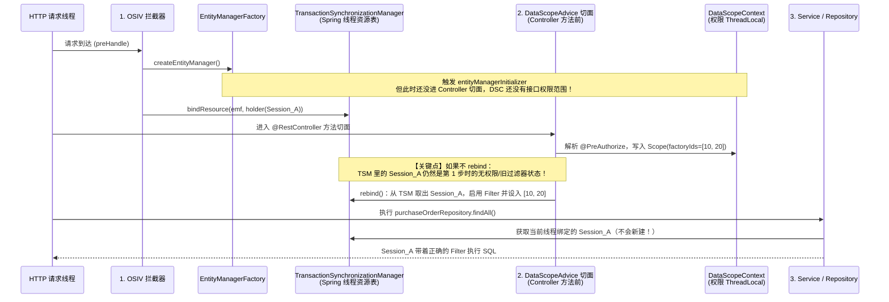

要理解为什么文档第 380 行强调**“在切面写入上下文、`DataScope.call` 切换和恢复时，对当前线程已绑定的 Session 重新绑定一次”**，核心在于理解 **“权限上下文（`ThreadLocal`）”** 与 **“Hibernate `Session` 过滤器状态”** 在生命周期和存储位置上的错位。

下面从底层基础机制出发，一步步拆解整个过程。

---

### 一、 核心原理一句话总结

Hibernate 的 `@Filter` 开关和参数是**保存在具体的 `Session`（即 JPA `EntityManager`）对象实例内部**的，而不是每次生成 SQL 时动态去读你的 `ThreadLocal`。
当 **`Session` 创建的时间早于权限上下文确定的时间**（如 OSIV），或者**在同一个 `Session` 存活期间中途修改了权限上下文**（如 `DataScope.call`），已经打开的那个 `Session` 不会自动感知 `ThreadLocal` 的变化，必须主动找到它并重新调用一次 `enableFilter` / `disableFilter`（即 `rebind`）。

---

### 二、 基础知识：三个核心组件是怎么工作的？

在阅读代码前，先理清参与这件事的三个角色：

#### 1. `DataScopeContext`（业务自己的 `ThreadLocal`）
```9:29:c:\WorkSpace\WorkSpace\lychee\lychee-backend\lychee-erp-common\src\main\java\com\lychee\erp\common\security\datascope\DataScopeContext.java
public final class DataScopeContext {

    private static final ThreadLocal<Scope> CURRENT = new ThreadLocal<>();
    // ...
    public record Scope(Collection<Long> factoryIds, Collection<Long> companyIds, boolean write) {
    }
}
```
* 它只是贴在当前线程上的一个“便签纸”，记录当前线程此刻的 `factoryIds`、`companyIds` 和读写模式。
* **关键点**：往 `ThreadLocal` 里 `set` 一个新值，**只是一个单纯的内存赋值操作，不会触发任何回调**，Hibernate 完全不知道你改了这个值。

#### 2. Hibernate `Session` 与 `@Filter` 的存储机制
```54:65:c:\WorkSpace\WorkSpace\lychee\lychee-backend\lychee-erp-common\src\main\java\com\lychee\erp\common\security\datascope\DataScopeFilterBinder.java
    private static void apply(Session session, List<String> filterNames, Collection<Long> ids) {
        for (String filterName : filterNames) {
            if (session.getEnabledFilter(filterName) != null) {
                session.disableFilter(filterName);
            }
            if (ids == null) {
                continue;
            }
            Collection<Long> parameter = ids.isEmpty() ? EMPTY_SCOPE : ids;
            session.enableFilter(filterName).setParameterList("ids", parameter);
        }
    }
```
* JPA 的 `EntityManager` 底层包装的就是 Hibernate 的 `Session`。
* 当你调用 `session.enableFilter("ds_purchase_orders").setParameterList("ids", parameter)` 时，Hibernate 是在**这个 `Session` 实例内部的成员变量**（一个 Map）里，记下了 `"ds_purchase_orders" -> [1, 2, 3]`。
* 之后用这个 `Session` 执行查询时，Hibernate 读的是 **`Session` 自己内部存的这份参数**。

#### 3. Spring 的 `TransactionSynchronizationManager`（管理 Session 与线程绑定的桥梁）
我们在 Service 或 Repository 里注入的 `@PersistenceContext EntityManager` 其实是一个**代理对象（Shared EntityManager Proxy）**。它怎么知道当前线程该用哪个真正的物理 `Session`？
* Spring 内部有一个核心类叫 `TransactionSynchronizationManager`，它里面也有一个 `ThreadLocal<Map<Object, Object>> resources`。
* 当一个事务开启（`@Transactional`）或者 OSIV 拦截器开启时，Spring 会创建一个真正的 `EntityManager`（内含 Hibernate `Session`），用 `EntityManagerHolder` 包起来，以 `EntityManagerFactory` 为 Key，放进 `TransactionSynchronizationManager` 的 `ThreadLocal` Map 里：
  $$\text{ThreadLocal Map}: \quad \text{EntityManagerFactory} \longrightarrow \text{EntityManagerHolder (持有已打开的 Session)}$$
* 只要这个 `Session` 已经挂在当前线程上了，后续整个调用链（Controller $\to$ Service $\to$ Repository）在执行数据库操作时，**都不会再创建新的 `EntityManager`**，而是直接从 `TransactionSynchronizationManager` 里拿出这个现成的 `Session` 来用。

---

### 三、 为什么必须“重新绑定（Rebind）”？（两大典型时序冲突）

理解了上面三点，再看为什么只靠 `DataScopeJpaConfiguration` 里的 `entityManagerInitializer`（新建 `EntityManager` 时自动绑定）是不够的：

#### 场景 1：OSIV（Open Session In View）导致的“先建 Session，后算权限”
Spring Boot Web 默认开启了 OSIV（`OpenEntityManagerInViewInterceptor`）。看一个标准 HTTP 请求的时间线：



1. **请求刚进门时（OSIV 阶段）**：`OpenEntityManagerInViewInterceptor` 在 Spring MVC 的 `preHandle` 阶段就调用了 `createEntityManager()`，把创建好的 `Session_A` 绑定到了当前线程（`TransactionSynchronizationManager`）。虽然此时触发了 `entityManagerInitializer`，但**这个时候根本还没走到 Controller 方法，切面还没执行，还不知道这次请求访问的是哪个权限串、是读模式还是写模式**。
2. **走到 Controller 切面时（`DataScopeAdvice`）**：切面解析出 `@PreAuthorize` 里的权限串，算出用户的组织范围，写进了 `DataScopeContext`。
3. **进入 Service/Repository 查询时**：因为当前线程在 `TransactionSynchronizationManager` 里已经绑定了 `Session_A`，Spring（包括里面的 `@Transactional` 事务）会**直接复用 `Session_A`**，不会再调 `createEntityManager()`。
4. **结论**：如果切面写入 `DataScopeContext` 后不去把已经挂在线程上的 `Session_A` 拿出来**重新绑定一次（rebind）**，`Session_A` 上就没有任何生效的业务范围过滤器，权限控制就会失效。

---

#### 场景 2：`DataScope.call(...)` 在中途切换与恢复权限范围
再看 `DataScope.java` 的代码：

```31:45:c:\WorkSpace\WorkSpace\lychee\lychee-backend\lychee-erp-common\src\main\java\com\lychee\erp\common\security\datascope\DataScope.java
    private void call(Collection<Long> factoryIds, Collection<Long> companyIds, boolean write, Runnable action) {
        DataScopeContext.Scope previous = DataScopeContext.get();
        DataScopeContext.set(new DataScopeContext.Scope(factoryIds, companyIds, write));
        try {
            rebind();
            action.run();
        } finally {
            if (previous == null) {
                DataScopeContext.clear();
            } else {
                DataScopeContext.set(previous);
            }
            rebind();
        }
    }
```

假设在导出任务（如 `ExportJobServiceImpl.createExportJob`）或某段业务代码中：
* **进入 `DataScope.call` 前**：当前线程可能已经有 OSIV 打开的 `Session`，或者外层已经在一个 `@Transactional` 事务中，此时 `Session` 上绑定的是外层接口的权限范围 `previous`。
* **`try` 块开头的 `rebind()`**：`DataScopeContext.set(...)` 切换成了导出处理器的权限范围。如果不调用 `rebind()`，接下来 `action.run()` 复用当前线程的 `Session` 查库时，用的还是切换前的 `previous` 过滤器。
* **`finally` 块里的 `rebind()`**：`action.run()` 执行完毕后，`DataScopeContext` 恢复成了原来的 `previous`（或清空）。但外层方法还没结束，那个 `Session` 依然存活在当前线程上！如果不在 `finally` 里再 `rebind()` 一次，这个 `Session` 内部残留的就还是刚才 `action` 里的过滤器状态，后续外层代码继续用这个 `Session` 就会发生权限串台。

---

### 四、 “新建时绑定” + “切换时重绑”如何共同覆盖全部 4 种场景？

把 `DataScopeJpaConfiguration`（新建时绑定）和 `DataScope.rebind()`（切换时对已有 Session 重绑）结合起来看，就能明白文档 **4.5 节《过滤器绑定》** 中列出的四种 `EntityManager` 来源是如何被严密覆盖的：

| 场景来源 | 底层发生了什么 | 靠哪个机制生效？ |
| :--- | :--- | :--- |
| **1. OSIV（所有 Web 请求）** | 请求一开始就建好了 `Session` 挂在线程上，之后切面或 `DataScope.call` 才设置好 `DataScopeContext` | **靠 `rebind()`**：通过 `TransactionSynchronizationManager.getResource(...)` 找到已打开的 OSIV `Session` 重新刷入 Filter。 |
| **2. `REQUIRES_NEW` 新事务**（如发票动作处理器） | 挂起老事务和老 `Session`，**当场调用 `createEntityManager()` 新建一个全新的 `Session`** | **靠 `entityManagerInitializer`**：新 `Session` 创建时直接读取当前线程的 `DataScopeContext` 绑定 Filter。 |
| **3. 非事务的共享 EntityManager**（如 `NOT_SUPPORTED` 导出） | 当 OSIV 关闭或挂起、且无事务时，每次 Repository 调用都会临时新建一个 `EntityManager` 用完即关 | **靠 `entityManagerInitializer`**：每次临时新建 `EntityManager` 时自动按当前线程的 `DataScopeContext` 绑定。 |
| **4. 异步线程**（导出、导入监听器） | 异步线程没有 OSIV，进入业务方法后用 `DataScope.call` 包住，内部无论是已打开的 Session 还是随后开启事务新建的 Session | 切换时已有的靠 **`rebind()`**，之后开启事务新建的靠 **`entityManagerInitializer`**。 |

### 五、 顺带解释 `DataScope.rebind()` 里的三行调用

```47:56:c:\WorkSpace\WorkSpace\lychee\lychee-backend\lychee-erp-common\src\main\java\com\lychee\erp\common\security\datascope\DataScope.java
    private void rebind() {
        EntityManagerFactory nativeFactory = entityManagerFactory;
        if (entityManagerFactory instanceof EntityManagerFactoryInfo info) {
            nativeFactory = info.getNativeEntityManagerFactory();
        }
        DataScopeFilterBinder.rebindBoundSession(nativeFactory);
        DataScopeFilterBinder.rebindBoundSession(entityManagerFactory);
        EntityManager current = EntityManagerFactoryUtils.getTransactionalEntityManager(entityManagerFactory);
        DataScopeFilterBinder.bind(current);
    }
```
这里之所以写得这么稳妥，是因为在 Spring / 测试环境中向 `TransactionSynchronizationManager` 注册资源时的 Key 可能是 Spring 包装后的代理 `EntityManagerFactory`，也可能是底层的 `nativeFactory`（比如测试代码手写 `bindResource` 时）；同时加上 `EntityManagerFactoryUtils.getTransactionalEntityManager(entityManagerFactory)` 获取当前事务关联的 `EntityManager`。这三步本质上都是在做同一件事：**只要当前线程上已经有打开的 `Session`，就把它找出来，按最新的 `DataScopeContext` 重新刷一遍 Hibernate Filter。**